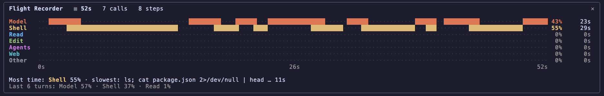
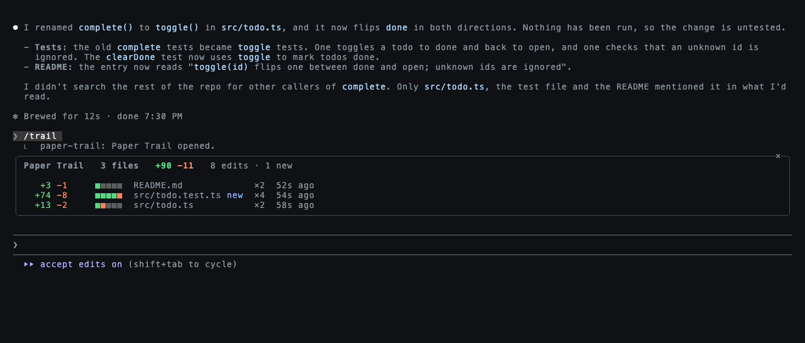
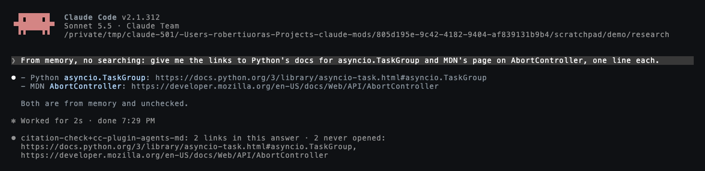

<h1 align="center">Claude Code mods</h1>

<p align="center">
  Small add-ons that change what <a href="https://claude.com/claude-code">Claude Code</a> shows you and what it is allowed to do.<br>
  Each one installs with a single line and works on its own.
</p>

<p align="center">
  
  
  
</p>

| Mod | What it does | Type |
|---|---|---|
| [**Flight Recorder**](#flight-recorder) | Shows, live, where each turn's time goes: the model, shell, reading, editing, sub-agents, web. | `/flight` |
| [**Paper Trail**](#paper-trail) | A live list of every file Claude changed this session, with lines added and removed. | `/trail` |
| [**Safety Net**](#safety-net) | Refuses commands that wipe your disk; asks you before a hard reset, a force push to main or a dropped table. | `/safety-net` |
| [**Citation Check**](#citation-check) | One line under an answer naming the links Claude never actually opened. | nothing, it just runs |

## Install

In Claude Code, install any mod by name:

```
/plugin install paper-trail --marketplace robertiuoras/claude-mods
```

Swap `paper-trail` for `flight-recorder`, `safety-net` or `citation-check`. Or add the whole collection once with `/plugin marketplace add robertiuoras/claude-mods` and pick from `/plugin`.

---

## Flight Recorder

Where did that 4-minute turn go? Type `/flight` and watch it: one row per kind of work paints live while Claude works. When the turn ends you get the split, the slowest single call, and a running total over your last 20 turns.



[How it counts →](flight-recorder/README.md)

## Paper Trail

What did Claude just touch? Type `/trail` for a live `git diff --stat` of the session: each file Claude edited or created, lines added and removed, how many times, and when. Newest on top.



[More →](paper-trail/README.md)

## Safety Net

Some commands you can't take back. Safety Net reads every shell command before it runs. `rm -rf ~`, wiping a disk or `chmod -R 777 /` are refused outright. `git reset --hard`, a force push to `main`, `git clean -fdx`, `DROP TABLE`, `terraform destroy` and `curl … | sh` stop and ask you first, even in bypass or auto mode. It reads commands the way a shell does, so `sudo`, `bash -c`, `$( … )` and `&&` chains don't slip past, and a commit message that merely mentions `rm -rf` doesn't trip it.


[The full list →](safety-net/README.md)

## Citation Check

Claude sometimes cites pages it never read. When an answer has links, Citation Check adds one line under it naming the ones Claude never opened in this session, so you know which to check before you trust them. It costs no tokens: Claude never sees the line.



[What counts as opened →](citation-check/README.md)

---

<p align="center">
  Built with Claude Code's mod API: hooks, panes and slash commands, each mod a few hundred lines of TypeScript with its own tests (<code>claude plugin test &lt;mod&gt;</code>).<br>
  MIT licensed. Issues and ideas welcome.
</p>
