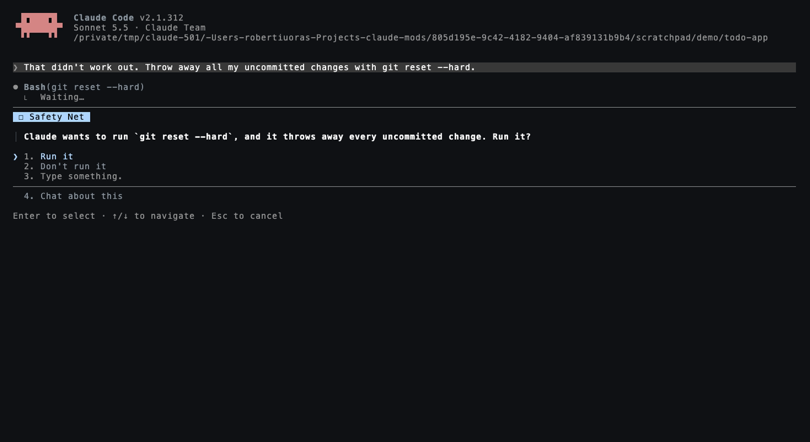

# Safety Net

A Claude Code mod that stops the shell commands you can't take back.

Some commands are never what you meant. Safety Net refuses those outright. Others are sometimes right and sometimes a disaster, so it stops and asks you first, in Claude Code's own question box, before the command runs. It works in every permission mode, including bypass and auto mode, where nothing else would have asked.



## What it stops

**Refused outright.** Claude is told why, and that you can run it yourself with `! <command>` if you really mean it.

| Command | Why |
|---|---|
| `rm -rf /`, `rm -rf ~`, `rm -rf $HOME/*`, `rm -rf /usr` and other system folders | deletes the disk, your home folder or the system |
| `find ~ … -delete`, `find / -exec rm` | the same, through `find` |
| `chmod -R` / `chown -R` on `/`, `~` or a system folder | breaks every file's permissions |
| `mkfs`, `dd of=/dev/disk2`, `diskutil eraseDisk`, `> /dev/sda` | erases a disk |
| `:(){ :|:& };:` | a fork bomb |

**Asked first.** Pick *Run it* and the command runs; anything else and it doesn't.

| Command | Why |
|---|---|
| `git reset --hard`, `git checkout -- .`, `git restore .` | throws away uncommitted work |
| `git clean -fd`, `git clean -fdx` | deletes untracked (and ignored, like `.env`) files |
| `git push --force` to `main`, `master`, `trunk`, `prod`; deleting those on the remote; `--mirror` | rewrites or deletes shared history |
| `git stash drop` / `clear` | deletes saved work |
| `rm -rf .`, `rm -rf *`, `rm -rf ..`, `rm -rf .git` | empties the project, or its history |
| `curl … \| sh`, `wget … \| bash` | runs a script from the internet nobody has read |
| `DROP TABLE`, `DROP DATABASE`, `TRUNCATE` through `psql`, `mysql`, `sqlite3` and friends; `dropdb`; `supabase db reset`; `prisma migrate reset`; `rails db:drop` | deletes data |
| `terraform destroy`, `kubectl delete namespace`, `docker volume prune`, `docker system prune --volumes` | tears down infrastructure or its data |

It reads the command the way a shell would, so it is not fooled by `sudo`, `env`, `/bin/rm`, `bash -c '…'`, `eval`, `$( … )`, or one dangerous command hidden in a `&&` chain. It is not tripped by text that only mentions a command: a commit message, an `echo`, a `grep` for `DROP TABLE`, or a heredoc writing a migration file.

## Install

Needs Claude Code 2.1.287 or later.

```
/plugin install safety-net --marketplace robertiuoras/claude-mods
```

Type `/safety-net` to see what it caught in this session. The status line shows a count once anything is stopped.

## Good to know

- It guards the shell commands Claude runs (the Bash tool). Commands you type yourself with `!` are yours and are never checked.
- It is a safety net, not a sandbox: a determined script can always do damage in ways no pattern list sees. It is there for the honest mistake, which is the one that usually happens.
- If its own check ever fails, the command runs as if Safety Net were not installed, so a bug in it can't stop your work. Once it has decided to stop a command, nothing that fails afterwards lets the command through.
- Nothing leaves your machine. What it caught is kept for the current session only.
